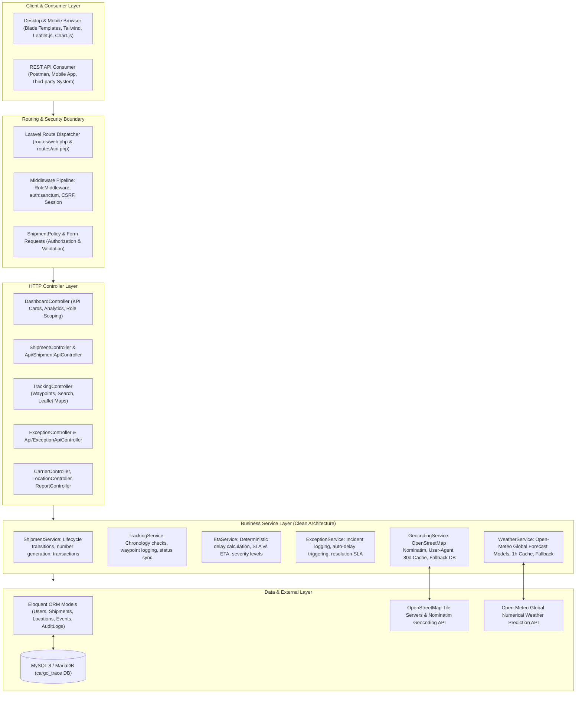

# WorldCargo 360 – Architecture Specification & Guideline
### *Track Beyond Borders.*

## 1. High-Level Architecture Flow

Following the strict architecture guidelines of the course:
`Browser / Client → Routes + Middleware → Controllers → Service Layer → Models / Eloquent → MySQL / External Services`

---

## 2. Service Layer Responsibilities

### `ShipmentService`
- Generates unique tracking numbers matching format `SHP-YYYY-XXXXXX`.
- Manages DB Transactions when creating shipments with multi-item manifests.
- Enforces valid lifecycle status flow:
  `CREATED` &rarr; `BOOKED` &rarr; `PICKED_UP` &rarr; `IN_TRANSIT` &rarr; `DELIVERED`.
- Enforces terminal status lock: once marked `DELIVERED`, status cannot jump backwards.
- Triggers ETA delay recalculation and audit logging.

### `TrackingService`
- Ensures chronological consistency: new event timestamp `event_time` must not be earlier than existing historical waypoints.
- Automatically updates shipment's `current_location_id` and `current_status`.
- Creates in-app notifications and records audit logs.

### `EtaService`
- Compares `estimated_arrival` against `expected_arrival` (scheduled delivery deadline).
- Evaluates delay duration in minutes and hours.
- Maps delay duration to severity:
  - $\le 0$ hours: `NONE`
  - $0 < \text{delay} \le 6$ hours: `LOW`
  - $6 < \text{delay} \le 24$ hours: `MEDIUM` (12h recommended scenario threshold)
  - $> 24$ hours: `HIGH`
- Configurable via `config/cargotrace.php`.

### `ExceptionService`
- Manages incident lifecycle: `OPEN` &rarr; `INVESTIGATING` &rarr; `RESOLVED`.
- Logs matching tracking events flagged as `is_exception = true`.
- Automatically raises shipment delay status and records resolution audit trail with timestamps.

### `GeocodingService`
- Connects to OpenStreetMap Nominatim via Laravel HTTP Client with proper user agent header.
- Implements 30-day response caching (`Cache::remember`).
- Features robust fallback database of major global ports and airports (Rotterdam, Los Angeles, Tokyo, Singapore, Jakarta, Santos, Durban, Frankfurt, etc.) for offline and rate-limited operation.

### `WeatherService`
- Connects to Open-Meteo live API for worldwide weather observations (temperature, wind, precipitation, condition).
- Implements 1-hour caching.
- Handles timeouts and failures without interrupting application flow.

