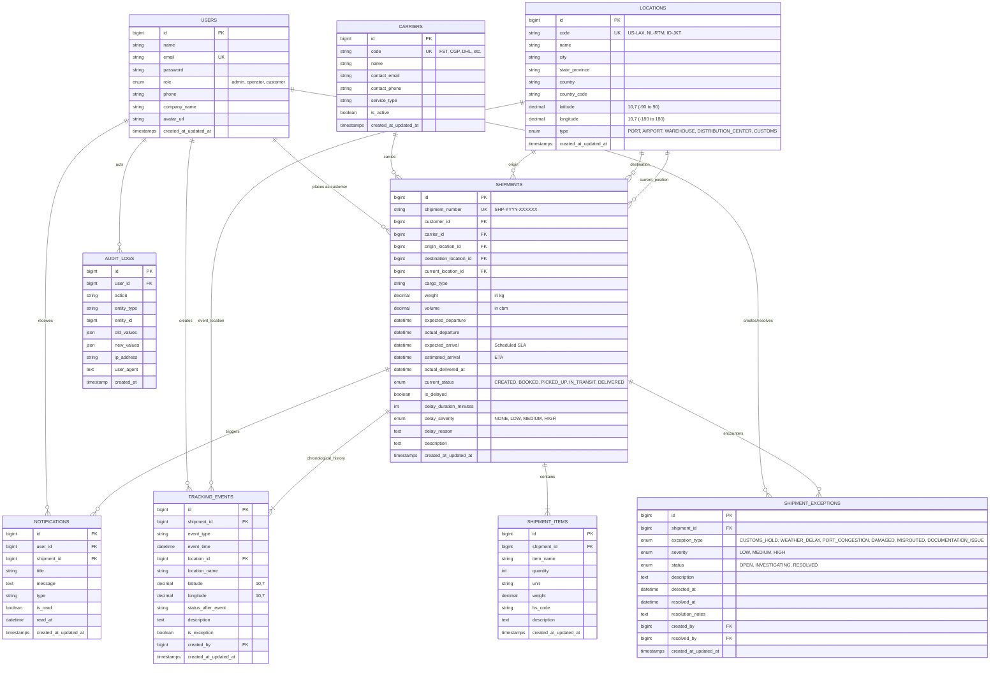

# WorldCargo 360 – Entity Relationship Diagram (ERD) & Data Dictionary
### *Track Beyond Borders.*

## 1. Entity-Relationship Diagram (ERD)

---

## 2. Cardinality Analysis & Design Decisions

| Relationship | Cardinality | Justification & Cascade Behavior |
|---|---|---|
| `users` &rarr; `shipments` | **1 to Many (1:N)** | One customer user can place multiple international shipments. A shipment belongs to exactly one customer user. If a user is deleted, their shipments cascade or are archived. |
| `carriers` &rarr; `shipments` | **1 to Many (1:N)** | Each carrier (e.g. FastShip, CargoPro) handles multiple shipments across international lanes. `restrictOnDelete` protects carrier deletion when active shipments exist. |
| `locations` &rarr; `shipments` | **1 to Many (1:N)** | A single worldwide hub can be the origin, destination, or current checkpoint of numerous shipments. `restrictOnDelete` preserves historical location integrity. |
| `shipments` &rarr; `shipment_items` | **1 to Many (1:N)** | Each shipment consists of one or more manifest items (boxes, pallets, containers). Deleting a shipment automatically cascades and cleans up child item manifests. |
| `shipments` &rarr; `tracking_events` | **1 to Many (1:N)** | Tracking events are historical and immutable. A shipment accumulates chronological waypoints. `cascadeOnDelete` cleans up events if the parent order is deleted. |
| `shipments` &rarr; `shipment_exceptions` | **1 to Many (1:N)** | A shipment may encounter zero, one, or multiple operational exceptions during transit (e.g. weather delay followed by port congestion). |
| `users` &rarr; `notifications` | **1 to Many (1:N)** | Each user receives dedicated in-app notification alerts regarding their shipments, state changes, and delay warnings. |
| `users` &rarr; `audit_logs` | **1 to Many (1:N)** | All security, login, and modification actions are logged against the acting actor. `nullOnDelete` preserves audit trail records even if an account is removed. |

---

## 3. Data Dictionary

### Table 1: `users`
- `id`: BIGINT UNSIGNED AUTO_INCREMENT PRIMARY KEY.
- `name`: VARCHAR(255) NOT NULL. User's full name.
- `email`: VARCHAR(255) NOT NULL UNIQUE. Login email.
- `password`: VARCHAR(255) NOT NULL. Bcrypt hashed password.
- `role`: ENUM('admin', 'operator', 'customer') NOT NULL DEFAULT 'customer'. System privilege tier.
- `phone`: VARCHAR(50) NULL. Contact telephone.
- `company_name`: VARCHAR(255) NULL. Organization or freight consignee.
- `avatar_url`: VARCHAR(255) NULL. Profile avatar image.
- `created_at`, `updated_at`: TIMESTAMP NULL.

### Table 2: `carriers`
- `id`: BIGINT UNSIGNED AUTO_INCREMENT PRIMARY KEY.
- `code`: VARCHAR(20) NOT NULL UNIQUE. Standard carrier code (e.g. FST, CGP).
- `name`: VARCHAR(100) NOT NULL. Commercial company name.
- `contact_email`: VARCHAR(255) NULL. Dispatch email.
- `contact_phone`: VARCHAR(50) NULL. Operations telephone.
- `service_type`: VARCHAR(50) NOT NULL DEFAULT 'Multimodal'. Air, Ocean, Road, or Multimodal.
- `is_active`: BOOLEAN NOT NULL DEFAULT TRUE. Operational availability status.

### Table 3: `locations`
- `id`: BIGINT UNSIGNED AUTO_INCREMENT PRIMARY KEY.
- `code`: VARCHAR(30) NOT NULL UNIQUE. Port/hub identifier (e.g. US-LAX, NL-RTM).
- `name`: VARCHAR(150) NOT NULL. Full facility name.
- `city`: VARCHAR(100) NOT NULL. City name.
- `state_province`: VARCHAR(100) NULL. State or administrative province.
- `country`: VARCHAR(100) NOT NULL. Country name.
- `country_code`: VARCHAR(10) NOT NULL. ISO alpha-2 country code.
- `latitude`: DECIMAL(10, 7) NOT NULL. Worldwide latitude (-90.0000000 to +90.0000000).
- `longitude`: DECIMAL(10, 7) NOT NULL. Worldwide longitude (-180.0000000 to +180.0000000).
- `type`: ENUM('PORT', 'AIRPORT', 'WAREHOUSE', 'DISTRIBUTION_CENTER', 'CUSTOMS') NOT NULL.

### Table 4: `shipments`
- `id`: BIGINT UNSIGNED AUTO_INCREMENT PRIMARY KEY.
- `shipment_number`: VARCHAR(50) NOT NULL UNIQUE. Tracking reference (SHP-YYYY-XXXXXX).
- `customer_id`: BIGINT UNSIGNED NOT NULL. FK to users.id.
- `carrier_id`: BIGINT UNSIGNED NOT NULL. FK to carriers.id.
- `origin_location_id`: BIGINT UNSIGNED NOT NULL. FK to locations.id.
- `destination_location_id`: BIGINT UNSIGNED NOT NULL. FK to locations.id.
- `current_location_id`: BIGINT UNSIGNED NULL. FK to locations.id.
- `cargo_type`: VARCHAR(100) NOT NULL. Commodity classification.
- `weight`: DECIMAL(10, 2) NOT NULL. Consignment weight in kilograms.
- `volume`: DECIMAL(10, 2) NOT NULL. Consignment volume in cubic meters.
- `expected_departure`: DATETIME NOT NULL. Scheduled departure.
- `actual_departure`: DATETIME NULL. Actual terminal departure.
- `expected_arrival`: DATETIME NOT NULL. Scheduled delivery deadline (SLA).
- `estimated_arrival`: DATETIME NOT NULL. Computed dynamic arrival (ETA).
- `actual_delivered_at`: DATETIME NULL. Final delivery timestamp.
- `current_status`: ENUM('CREATED', 'BOOKED', 'PICKED_UP', 'IN_TRANSIT', 'DELIVERED') NOT NULL DEFAULT 'CREATED'.
- `is_delayed`: BOOLEAN NOT NULL DEFAULT FALSE. Flagged when estimated_arrival > expected_arrival.
- `delay_duration_minutes`: INT NOT NULL DEFAULT 0. Total minutes behind schedule.
- `delay_severity`: ENUM('NONE', 'LOW', 'MEDIUM', 'HIGH') NOT NULL DEFAULT 'NONE'.
- `delay_reason`: TEXT NULL. Contextual reason for delay.
- `description`: TEXT NULL. Handling instructions.

### Table 5: `shipment_items`
- `id`: BIGINT UNSIGNED AUTO_INCREMENT PRIMARY KEY.
- `shipment_id`: BIGINT UNSIGNED NOT NULL. FK to shipments.id (CASCADE).
- `item_name`: VARCHAR(150) NOT NULL. Item description.
- `quantity`: INT NOT NULL. Number of units.
- `unit`: VARCHAR(30) NOT NULL DEFAULT 'units'. Pallets, boxes, crates, units.
- `weight`: DECIMAL(10, 2) NULL. Weight in kg.
- `hs_code`: VARCHAR(30) NULL. Harmonized System customs code.
- `description`: TEXT NULL. Specific package notes.

### Table 6: `tracking_events`
- `id`: BIGINT UNSIGNED AUTO_INCREMENT PRIMARY KEY.
- `shipment_id`: BIGINT UNSIGNED NOT NULL. FK to shipments.id (CASCADE).
- `event_type`: VARCHAR(50) NOT NULL. Waypoint classification.
- `event_time`: DATETIME NOT NULL. Occurrence timestamp.
- `location_id`: BIGINT UNSIGNED NULL. FK to locations.id (SET NULL).
- `location_name`: VARCHAR(150) NOT NULL. Name of location or corridor.
- `latitude`: DECIMAL(10, 7) NULL. Event coordinate latitude.
- `longitude`: DECIMAL(10, 7) NULL. Event coordinate longitude.
- `status_after_event`: VARCHAR(50) NOT NULL. Shipment lifecycle status.
- `description`: TEXT NOT NULL. Waypoint description.
- `is_exception`: BOOLEAN NOT NULL DEFAULT FALSE. True if caused by operational incident.
- `created_by`: BIGINT UNSIGNED NOT NULL. FK to users.id.

### Table 7: `shipment_exceptions`
- `id`: BIGINT UNSIGNED AUTO_INCREMENT PRIMARY KEY.
- `shipment_id`: BIGINT UNSIGNED NOT NULL. FK to shipments.id (CASCADE).
- `exception_type`: ENUM('CUSTOMS_HOLD', 'WEATHER_DELAY', 'PORT_CONGESTION', 'DAMAGED', 'MISROUTED', 'DOCUMENTATION_ISSUE') NOT NULL.
- `severity`: ENUM('LOW', 'MEDIUM', 'HIGH') NOT NULL DEFAULT 'MEDIUM'.
- `status`: ENUM('OPEN', 'INVESTIGATING', 'RESOLVED') NOT NULL DEFAULT 'OPEN'.
- `description`: TEXT NOT NULL. Full incident report.
- `detected_at`: DATETIME NOT NULL. Detection timestamp.
- `resolved_at`: DATETIME NULL. Resolution timestamp.
- `resolution_notes`: TEXT NULL. Resolution outcome summary.
- `created_by`: BIGINT UNSIGNED NOT NULL. FK to users.id.
- `resolved_by`: BIGINT UNSIGNED NULL. FK to users.id.

### Table 8: `notifications`
- `id`: BIGINT UNSIGNED AUTO_INCREMENT PRIMARY KEY.
- `user_id`: BIGINT UNSIGNED NOT NULL. FK to users.id (CASCADE).
- `shipment_id`: BIGINT UNSIGNED NULL. FK to shipments.id (CASCADE).
- `title`: VARCHAR(150) NOT NULL. Notification title.
- `message`: TEXT NOT NULL. Detail message body.
- `type`: VARCHAR(50) NOT NULL. Notification category tag.
- `is_read`: BOOLEAN NOT NULL DEFAULT FALSE.
- `read_at`: DATETIME NULL.

### Table 9: `audit_logs`
- `id`: BIGINT UNSIGNED AUTO_INCREMENT PRIMARY KEY.
- `user_id`: BIGINT UNSIGNED NULL. FK to users.id (SET NULL).
- `action`: VARCHAR(100) NOT NULL. Action code (e.g. USER_LOGIN, STATUS_TRANSITION).
- `entity_type`: VARCHAR(100) NOT NULL. Affected Eloquent model name.
- `entity_id`: BIGINT UNSIGNED NULL. Record ID.
- `old_values`: JSON NULL. Pre-mutation state.
- `new_values`: JSON NULL. Post-mutation state.
- `ip_address`: VARCHAR(45) NULL. Client IP address.
- `user_agent`: TEXT NULL. Client browser / device string.
- `created_at`: TIMESTAMP NOT NULL DEFAULT CURRENT_TIMESTAMP.

